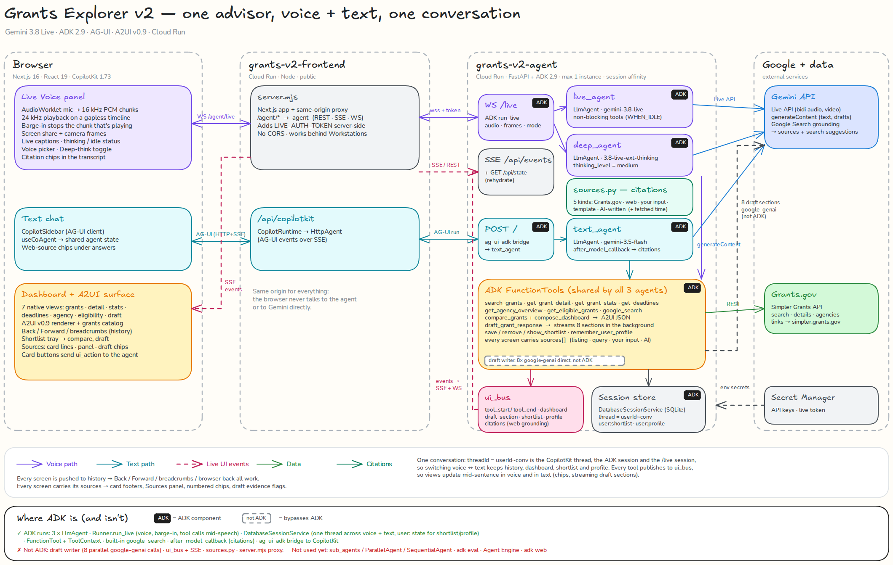

# Grants Explorer v2

A grants advisor you can talk to or type to — one conversation across both. Built on Google ADK, the Gemini Live API, AG-UI (CopilotKit) and A2UI.



## Layout

- `agent/` — Python FastAPI + ADK backend. Three `LlmAgent`s (live voice, deep-think voice, text) share one set of FunctionTools that search Grants.gov via the Simpler Grants API, build dashboards as A2UI, and draft proposal sections.
- `frontend/` — Next.js app with a same-origin proxy (`server.mjs`) to the agent, a CopilotKit text sidebar, a live voice panel, and an A2UI dashboard surface.
- `docs/` — architecture diagram (`.png` and editable `.excalidraw`).

## Run locally

```bash
# Agent
cd agent
cp .env.example .env   # fill in your keys
pip install -r requirements.txt
python3 agent.py        # http://localhost:8001

# Frontend
cd frontend
npm install
AGENT_URL=http://localhost:8001/ npm run dev   # http://localhost:3000
```

## Deploy

Both folders have a `Dockerfile` and `cloudbuild.yaml` for Cloud Run. Replace the `YOUR_PROJECT_ID` / `YOUR_REPO` / `YOUR-AGENT-SERVICE` placeholders, and keep API keys in Secret Manager.
